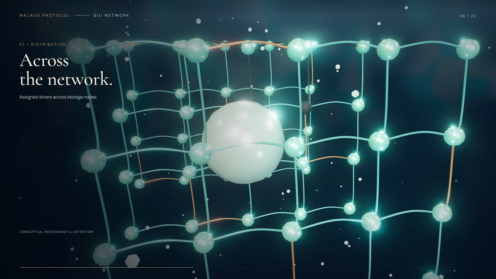

# The Memory Between

<!-- public-film-portfolio -->

[Watch/download the finished film and editable source](https://github.com/cryptokali007/the-memory-between/releases/tag/v1.0.0)

Completed film, 300 seconds at 60 fps. This repository contains the editable composition and source media; finished video exports are distributed separately.

The composition includes the operator-provided closing media and locally synthesized score and narration.

## Source and production

The composition starts at `index.html` and `film.js`; local source assets are in `assets/`. Subtitle files, when present, are editable. No package lock was present in the source project. Declared dependencies: hyperframes 0.8.193, three 0.186.1, gsap 3.15.0, playwright 1.64.1.

Install Node.js and the locked dependencies with `npm ci`. Then use `npm run preview`, `npm run check`, or `npm run render`. The portable wrapper resolves the CLI from this project's installed, pinned HyperFrames package. Rendering also requires a compatible Chromium browser and full FFmpeg/FFprobe installation; configure these for your environment as supported by the pinned HyperFrames version. GPU support depends on the host. These commands have not yet been validated with a clean-machine production render. Ready audio is included; regenerating synthesized voice requires separately provisioned models and tooling.

The lockfile was generated for this publication package from the original project’s exact direct dependency versions; it is not a recovered production lockfile. Some source-generation helpers containing machine-specific paths were omitted. The composition and included source media remain unchanged.

Sui and Walrus are named as ecosystem technologies; their names and marks belong to their respective owners. See included notices and licenses for third-party components. No new blanket license is assigned to the film source.
